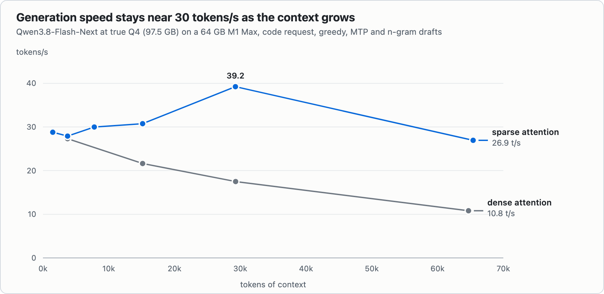

<div align="center">

# NInfer-M1

### A 180-billion-parameter model on a 64 GB MacBook

**[Qwen3.8-Flash-Next](https://huggingface.co/Qwen/Qwen3.8-Flash-Next) at true Q4: a 97.5 GB file, 1.5× the memory of the Mac, at about 30 tokens/s, 29 tokens/s after a 28,000-token prompt, every token checked by the full model.**

<a href="docs/ninfer-m1/BENCHMARKS.md"><picture>
  <source media="(prefers-color-scheme: dark)" srcset="docs/ninfer-m1/images/engines-dark.png">
  
</picture></a>

[Benchmarks](docs/ninfer-m1/BENCHMARKS.md) · [How it works](docs/ninfer-m1/HOW_IT_WORKS.md) · [Three weeks, one laptop](docs/ninfer-m1/JOURNEY.md) · [Italiano](docs/ninfer-m1/README.it.md) · [Hugging Face](https://huggingface.co/Nervitesi/Qwen3.8-Flash-Next-NInfer-M1)

</div>

The model is a mixture of experts: 125 B parameters of which only 6 B are active for each token, plus a 51 B n-gram
embedding table. At Q4 its file is **97.5 GB**; the Mac has **64 GB**. NInfer-M1, a llama.cpp fork tuned for the M1,
keeps the most used experts in a Metal cache, **streams the others from the SSD while the GPU works**, switches on the
sparse attention that the GGUF had lost, and drafts with the model's own MTP head. **Every drafted token is checked by
the full model**, so nothing is approximated: with MTP drafts the greedy text matched plain decoding in every request
we compared.

It runs as an OpenAI- and Anthropic-compatible server, and it has been the daily local backend of Claude Code on this
machine since October 2026.

## The numbers

Same file, same Mac, same prompts, one engine at a time (M1 Max, 64 GB, greedy, 14 October 2026):

| | short prompts | after a 28k-token prompt | reading that prompt |
|---|---:|---:|---:|
| **NInfer-M1** | **30.9 tok/s** | **29.1 tok/s** | **2 min 08 s** (220 tok/s) |
| streaming llama.cpp fork (mihailescu2m) | 16.0 | 13.2 | 6 min 56 s (68 tok/s) |
| llama.cpp master, `--cpu-moe` | 9.7 | 4.8 | 19 min 38 s (24 tok/s) |

**1.9× and 3.2× on short prompts, 2.2× and 6.1× at 28k tokens of context, and the prompt is read 3.3× and 9.2× faster.**
Without any speculative drafts NInfer-M1 still does 22.8 tok/s against 9.7. (Measured with an MTP draft that has a
64k-token sub-head; the stock draft of the quick start gives 29.7 tok/s on the short prompts, 4% less.)

- **Context barely slows it down:** ~29 tok/s at 1.5k tokens, ~31 at 15k, **27 at 65k** (dense attention: 11).
  The prompt is read at 210–217 tok/s from 8k to 65k tokens.
- **Same answers:** on twelve graded tasks the text is identical to the streaming fork's in 12 of 12 and to llama.cpp
  master's in 11 of 12 (the twelfth differs in the whitespace of a JSON object), and all three pass the same nine. Over
  longer answers any two engines, and two drafts of the same engine, can part ways at a near-tie token, as floating-point
  inference does; see [BENCHMARKS](docs/ninfer-m1/BENCHMARKS.md#same-output).
- **A 180 B model streamed from the SSD matches the best MLX engine on a 27 B model that sits in memory** after a 28k-token
  prompt: 29.1 against 28.6 tok/s, and it reads the prompt 1.6× faster. When a model *fits* in memory, MLX is faster on
  short prompts (MTPLX: 37 tok/s on the 27 B); NInfer-M1 is for the models that do not.
- **Long agent sessions:** two 30k-token conversations taking turns answer in **5.6 s instead of 140 s** (the one that left
  the slot comes back from disk in 0.3 s); conversations survive a server restart.
- **Safe on a laptop:** 51.9 GiB of wired memory at every context length up to 65k, Metal allocations capped below the
  level where macOS kernel-panicked in an earlier test.

Methods, caveats, every engine's flags and the raw numbers: **[BENCHMARKS](docs/ninfer-m1/BENCHMARKS.md)**
(`scripts/ninfer-m1/bench_speed.py` measures your own engine the same way; start NInfer-M1 with `NGRAM=0`).

<p align="center"><picture>
  <source media="(prefers-color-scheme: dark)" srcset="docs/ninfer-m1/images/decode-vs-context-dark.png">
  
</picture></p>

## What makes it fast

- **Experts from the SSD, exact.** 286 of the 512 experts of each layer live in a 34 GiB Metal cache; a CPU step inside
  the GPU command stream reads the missing ones with 9 threads and rewrites the expert ids. Each layer's router runs
  *before* its attention to start the reads early. Same output as with all experts in memory.
- **The sparse attention, switched back on.** The Q4 GGUF stores compress ratio 0, so llama.cpp attends to the whole
  context. NInfer-M1 restores the model's query-selected attention (each query reads its best 2,048 tokens), chunked to fit
  the memory and deterministic from run to run: **×2.5 decode at 65k tokens**.
- **M1-specific Metal.** Metal 4 submission for graphs with CPU steps (the per-layer GPU↔CPU wait 0.2 → 0.05 ms), few-row
  matrix kernels with M1 thresholds for the 4-token verification (−25% on its dense products), hyper-connection kernels
  (+16–18%).
- **Drafts.** The MTP head proposes 3 tokens through a 64k-token sub-head (cheaper, same verification); n-gram drafts of
  up to 32 tokens for edits, held back while the model reasons.
- **Built for long agent sessions.** A second level of the prompt cache on disk, and the prompt cache survives restarts.

## Quick start

You need an Apple Silicon Mac with **64 GB** (tuned on an M1 Max), **macOS 26** recommended (Metal 4 submission is worth
~20% for the streaming; older systems fall back to the classic queue, which I have not tested), and **~100 GB free on the
internal SSD**: an external drive is too slow for the expert reads. The streaming is aimed at 64 GB machines; with much
more memory you do not need it.

**1. The engine**, either the prebuilt binary:

```bash
curl -LO https://github.com/nervitesi/NInfer-M1-Flash/releases/latest/download/ninfer-m1-flash-macos-arm64.tar.gz
tar xzf ninfer-m1-flash-macos-arm64.tar.gz     # a browser download needs: xattr -dr com.apple.quarantine ninfer-m1-flash
```

or build it (Xcode command line tools and CMake):

```bash
git clone https://github.com/nervitesi/NInfer-M1-Flash && cd NInfer-M1-Flash
cmake -B build -DCMAKE_BUILD_TYPE=Release -DGGML_METAL=ON -DLLAMA_OPENSSL=OFF -DBUILD_SHARED_LIBS=OFF
cmake --build build --target llama-server -j
```

**2. The weights** (not part of this repository):

```bash
hf download mradermacher/Qwen3.8-Flash-Next-i1-GGUF Qwen3.8-Flash-Next.i1-IQ4_XS.gguf --local-dir ~/models   # 97.5 GB
hf download unsloth/Qwen3.8-Flash-Next-GGUF MTP/mtp-Qwen3.8-Flash-Next-shared-Q8_0.gguf --local-dir ~/models   # 2.8 GB
```

**3. Run it:**

```bash
MODEL=~/models/Qwen3.8-Flash-Next.i1-IQ4_XS.gguf \
DRAFT=~/models/MTP/mtp-Qwen3.8-Flash-Next-shared-Q8_0.gguf \
scripts/ninfer-m1/run-flash-next-q4.sh        # from the tarball: ninfer-m1-flash/run-flash-next-q4.sh
```

The server listens on `127.0.0.1:8080` (OpenAI `/v1/chat/completions`, Anthropic `/v1/messages`). The first requests are
slower (24–26 tok/s): the expert cache starts empty and fills from the SSD. Leave ~10 GB of memory to the system. The
launcher explains every setting; do not raise the expert cache above 34 GiB on a 64 GB Mac. Its chat template is the
model's own with one change: a system message in the middle of a conversation (agents send them) is accepted.

```bash
curl -s http://127.0.0.1:8080/v1/chat/completions -H 'Content-Type: application/json' \
  -d '{"model":"qwen3.8-flash-next-q4","messages":[{"role":"user","content":"Hello!"}],"max_tokens":64}'
```

## Honest limits

- Built and measured on **one machine**: a 2021 MacBook Pro 16-inch, M1 Max, 64 GB, macOS 26. Other Apple Silicon chips
  are untested.
- It is a **fork of a fast-moving project** (llama.cpp base of 26 September 2026) tuned for **one model**. On dense models
  that fit in memory it is about 3% behind llama.cpp master, and MLX engines are faster still.
- Speculation is exact in the algorithm (a drafted token is kept only if the model itself picks it), not bit for bit in
  floating point: when the verification batch changes shape, a near-tie can flip a token (the stock draft changes one of
  three 256-token answers after 922 characters, n-gram drafts another after 429). Checked on greedy requests.
- The benchmarks leave n-gram drafts out (they replay repeated prompts); the launcher keeps them, because they speed up
  edits. `NGRAM=0` switches them off and gives the configuration of the tables.
- Not affiliated with the Qwen team, ggml-org, Apple, or the CUDA inference engine [ninfer](https://github.com/Neroued/ninfer).

## Credits

- **[llama.cpp / ggml](https://github.com/ggml-org/llama.cpp)** (MIT): this repository is a fork of it, based on `9588757`
  (2026-09-26). The full upstream history is kept.
- **[mihailescu2m](https://github.com/mihailescu2m/llama.cpp)**'s MoE expert streaming for llama.cpp (`d1762fc`, MIT): the starting
  point of the SSD path, and the engine NInfer-M1 is compared with.
- The authors of the upstream work ported here: MTP drafting (PR #28243), few-row MMA mat-mul (#29869, #30065, #30100),
  the qwen4exp mask construction (#29824) and the fixes #29638, #29340, #29856, #29019, #30295, #26004. Their commits keep
  their authorship.
- The Qwen team for the model, **mradermacher** for the i1-IQ4_XS quantization, **Unsloth** for the MTP GGUF.
- Built by [@nervitesi](https://github.com/nervitesi) with Claude (Anthropic) as pair programmer.

Third-party notices: [docs/ninfer-m1/NOTICE.md](docs/ninfer-m1/NOTICE.md). No model weights are distributed here; their
own licenses apply (the Qwen Community License 1.0 for the model).

## License

MIT, as llama.cpp (see [LICENSE](LICENSE)). The original llama.cpp README is in
[README.llama.cpp.md](README.llama.cpp.md).
