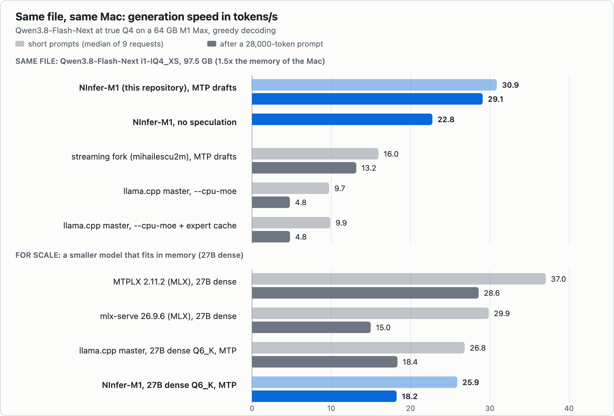
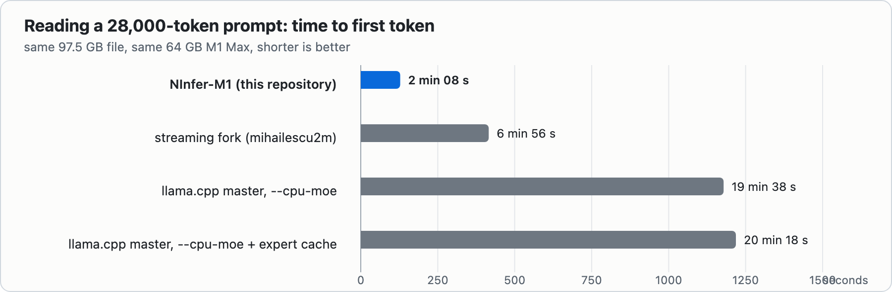

# Benchmarks: NInfer-M1 against the other engines

Measured on **14 October 2026**, one machine, one engine at a time:

| | |
|---|---|
| Machine | MacBook Pro 16-inch (2021), **M1 Max**, 10-core CPU, 32-core GPU, **64 GB** unified memory, 1 TB internal SSD, macOS 26.6.2 |
| The file | `Qwen3.8-Flash-Next.i1-IQ4_XS.gguf` (mradermacher), **97.5 GB**: 125 B parameters of mixture-of-experts (6 B active per token), a 51 B n-gram embedding table and the output head. 1.5x the memory of the Mac |
| NInfer-M1 | this repository, engine commit `cc0e766` (llama.cpp base `9588757`, 26 September 2026; the same code is in the tagged release) |
| MTP draft | Unsloth's `mtp-...-shared-Q8_0.gguf` with a 64k-token sub-head added (`scripts/ninfer-m1/draft_vocab_head.py`): about 4% faster than the stock file |
| Others | llama.cpp master `1b70350` (13 October 2026) · the MoE-streaming llama.cpp fork of [mihailescu2m](https://github.com/mihailescu2m/llama.cpp) `d1762fc` · MTPLX 2.11.2 (MLX) · mlx-serve 26.9.6 (MLX) |

Raw numbers, request by request, and the exact launch flags of every engine:
[`data/final-campaign-2026-10-14.json`](data/final-campaign-2026-10-14.json).



## How it was measured

- **Short prompts.** Three prompts (an Italian explanation, a Python function with tests, a quadratic equation), greedy
  (temperature 0), thinking off, **256 new tokens**. Per engine and prompt: 1 warm-up request, then 3 timed requests.
  Generation speed = (tokens - 1) / time between the first and the last streamed chunk, on the client; it excludes reading
  the prompt. "Median of 9" is the median of the 3 prompts x 3 timed requests.
- **One long request.** ~28,000 tokens of C++ and Python source as the system message, then a coding question, 400 new
  tokens, prompt cache off. *Wait* = time to the first content chunk; *read* = prompt tokens / wait.
- **Twelve graded tasks** (maths, Italian, JSON extraction, code reading; 128 tokens): a functional diagnostic, not a
  quality benchmark.
- The GPU is idle before each launch, nothing else runs, every engine is started fresh. Memory is the peak growth of
  wired + active + compressed memory while the engine was up.

## The same file, on the same Mac

Generation speed, tokens/s:

| Engine and flags | Italian | Code | Math | **Median of 9** | First request after start |
|---|---:|---:|---:|---:|---|
| **NInfer-M1**, MTP drafts | 32.8 | 30.9 | 29.6 | **30.9** | 24.3 / 24.2 / 26.1 |
| NInfer-M1, no speculation at all | 25.7 | 22.3 | 22.8 | 22.8 | 20.5 / 19.6 / 21.2 |
| streaming fork `d1762fc`, MTP drafts | 19.9 | 16.0 | 15.5 | 16.0 | 12.2 / 12.6 / 13.6 |
| llama.cpp master, `--cpu-moe` | 9.6 | 9.7 | 9.9 | 9.7 | 5.8 / 5.7 / 5.2 |
| llama.cpp master, `--cpu-moe --moe-cache-mib 34816` | 9.9 | 9.7 | 9.9 | 9.9 | 5.9 / 5.5 / 5.4 |

After one 28,000-token prompt:

| Engine | Wait for the first token | Prompt reading | Generation | Drafts accepted |
|---|---:|---:|---:|---:|
| **NInfer-M1**, MTP drafts | **2 min 08 s** | **220 tok/s** | **29.1 tok/s** | 288 / 295 |
| streaming fork `d1762fc` | 6 min 56 s | 68 tok/s | 13.2 tok/s | 289 / 329 |
| llama.cpp master, `--cpu-moe` | 19 min 38 s | 24 tok/s | 4.8 tok/s | no drafts |
| llama.cpp master + expert cache | 20 min 18 s | 23 tok/s | 4.8 tok/s | no drafts |



**Reading it.**

- Short prompts: **1.9x** the streaming fork, **3.2x** llama.cpp master. After 28k tokens of context: **2.2x** and
  **6.1x** the generation speed, and the prompt is read **3.3x** and **9.2x** faster.
- Not only speculation: with **no drafts at all** NInfer-M1 does 22.8 tok/s against 9.7 for llama.cpp master (2.3x).
- The first request after a start is slower (24-26 tok/s): the expert cache starts empty and fills from the SSD.
- Context hardly slows it down. On a code request with MTP and n-gram drafts: 28.8 tok/s at 1.5k tokens, 30.8 at 15k,
  39.2 at 29k (the answer copies text that is already in the context), **26.9 at 65k**. The sparse attention of the model,
  which this GGUF had lost, is switched back on: with dense attention the same prompts give 21.6 at 15k, 17.5 at 29k and
  10.8 at 65k. Chart in the [README](../../README.md).
- Memory: NInfer-M1 peaks at **51.8-51.9 GiB of wired memory at every context length up to 65k**, under the 54.3 GiB at
  which this Mac kernel-panicked in an earlier test.

llama.cpp master has no working path for the separate MTP draft of this model on Metal (it crashed on 2 October,
`GGML_ASSERT(buffer)` in the draft context; not retried today), so it runs without drafts. The no-speculation row above is
the like-for-like comparison with it.

## Same output

A drafted token is kept only if the model itself would have picked it, so speculation approximates nothing. What can
still differ is floating-point rounding: the verification is a batch of 4 rows with MTP drafts and up to 33 with n-gram
drafts, kernels add up in a different order, and on a near-tie another token can win. Every engine does this, NInfer-M1
between its own configurations too. Measured, against NInfer-M1 with MTP drafts:

| | the three 256-token answers (greedy) | twelve graded tasks, 128 tokens |
|---|---|---|
| NInfer-M1, no speculation | identical in 12 of 12 requests | - |
| NInfer-M1, MTP + n-gram drafts (the launcher) | 9 of 12: the Italian answer parts after 429 characters in the three requests that replay a repeated prompt | **12 / 12** |
| NInfer-M1, stock MTP draft (no sub-head), MTP only | 2 of 3 (code, measured separately: parts after 922 characters; the sub-head draft reproduces plain decoding there) | - |
| streaming fork `d1762fc` | 2 of 3 prompts (the code answer parts after 337 characters) | **12 / 12** |
| llama.cpp master (both configurations) | 1 of 3 prompts (Italian after 429 characters, code after 337) | 11 / 12 |

On the twelve tasks the passes are the same for all three engines: 9 of 12, the same three misses (that is the model, not
the engine). The twelfth answer of llama.cpp master differs only in the whitespace of a JSON object.

## For scale: models that fit in memory

The MLX engines cannot load a 97.5 GB file on a 64 GB Mac, so they ran **Qwen3.8 27B**, a dense model that fits; the
llama.cpp-based engines ran it too, at Q6_K. Different model, different quantization per engine: this table shows what
this Mac does with a model that fits, not who is better on the same one.

| Engine | Italian | Code | Math | Median of 9 | After 28k tokens: wait, read, generate |
|---|---:|---:|---:|---:|---|
| NInfer-M1 on the 3.84 bpw AtomicChat variant of Flash-Next (43 GiB resident), MTP drafts | 35.0 | 48.1 | 44.1 | 44.1 | 107 s, 264 tok/s, 37.3 tok/s (with n-gram drafts) |
| MTPLX 2.11.2 (MLX), 27B | 27.8 | 38.1 | 37.7 | 37.0 | 209 s, 135 tok/s, 28.6 tok/s |
| mlx-serve 26.9.6 (MLX), 27B | 24.2 | 31.0 | 30.0 | 29.9 | 260 s, 108 tok/s, 15.0 tok/s (it stops after 83 tokens) |
| llama.cpp master, 27B Q6_K, MTP | 20.6 | 27.7 | 26.8 | 26.8 | 248 s, 114 tok/s, 18.4 tok/s |
| NInfer-M1, 27B Q6_K, MTP | 19.4 | 26.4 | 25.9 | 25.9 | 248 s, 114 tok/s, 18.2 tok/s |
| llama.cpp master, 27B Q6_K, no drafts | 13.1 | 13.1 | 13.1 | 13.1 | 239 s, 118 tok/s, 11.5 tok/s |

- **When a model fits in memory, MLX is faster on short prompts** (MTPLX 37 tok/s against 26-27 for the llama.cpp-based
  engines). NInfer-M1 is for the models that do not fit.
- On a model that fits, NInfer-M1 is about 3% behind llama.cpp master (25.9 against 26.8): its base is two and a half
  weeks older, and nothing in it targets dense models.
- After 28k tokens, **the 180 B model streamed from the SSD generates as fast as the best MLX engine does on a 27B model
  that sits in memory (29.1 against 28.6 tok/s) and reads the prompt 1.6x faster (220 against 135 tok/s).**
- MTPLX answered the first 28k-token request in 3.6 s: it keeps a session cache on the SSD between runs, which held that
  prompt from an earlier run. The row above is a rerun with a random first line in the prompt.

## Caveats

- **N-gram drafts are left out of the comparison.** The launcher also uses n-gram drafts (they copy text that already
  appeared, which helps edits: +25-47% on agentic edit tasks). When a benchmark repeats a prompt, they replay the previous
  answer from history (all 246 drafted tokens accepted, 46-73 tok/s), which says nothing about real use. The rows above use
  MTP drafts only, so every row is a first-time answer.
- One machine, three prompts, three repeats: repeats of the same prompt differ by up to 10% (NInfer-M1 speeds up over the
  first repeats while its expert cache fills: 28.3, 29.6, 30.4 tok/s on the math prompt), prompts differ by up to 10%.
  256 or 400 new tokens are short samples.
- The other engines run with the flags listed in the JSON, the ones documented for offloading experts; nobody tuned them
  for this file as NInfer-M1 was tuned. A faster configuration of llama.cpp master may exist.
- Prompt-token counts differ by up to 40 tokens between engines (tokenizer and template handling).
- The twelve tasks are a functional diagnostic (`tests/flash/quality-task-prompts.json`, scored by
  `tools/evaluate_flash_tasks.py` in the lab repository), not a general quality certification.

## Run it yourself

[`scripts/ninfer-m1/bench_speed.py`](../../scripts/ninfer-m1/bench_speed.py) measures any OpenAI-compatible server the way
this page does. Start your engine (for NInfer-M1: `NGRAM=0 scripts/ninfer-m1/run-flash-next-q4.sh`, MTP drafts only, the
configuration of the tables; the default also uses n-gram drafts, which replay repeated prompts), then

```bash
python3 scripts/ninfer-m1/bench_speed.py --port 8080                 # 3 prompts x (1 warm-up + 3 timed), 256 tokens
python3 scripts/ninfer-m1/bench_speed.py --port 8080 --long-tokens 28000   # one long request, source files of this repository
```

The long prompt is built from the C++ sources of the repository you run it in, so its text differs from the one used
above; the protocol is the same. For reference, the published launcher with `NGRAM=0` and the stock Unsloth draft (no
64k sub-head) gave, on this Mac: 29.7 tok/s median on the short prompts (27.2-32.3), and after 28,125 tokens of this
repository's sources 138 s to the first token, 203 tok/s reading, 24.7 tok/s generation: a little lower than the tables
because of the stock draft (-4%) and the different prompt text.
